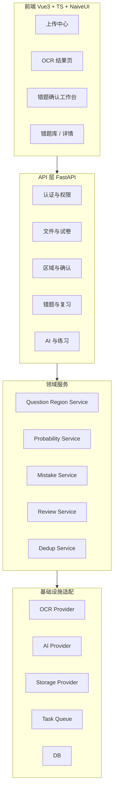
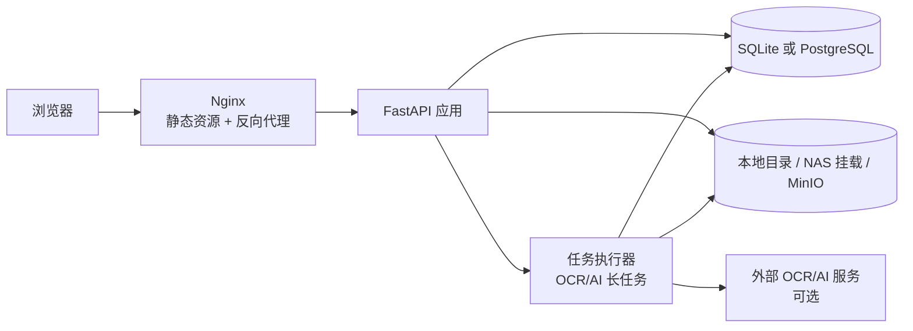
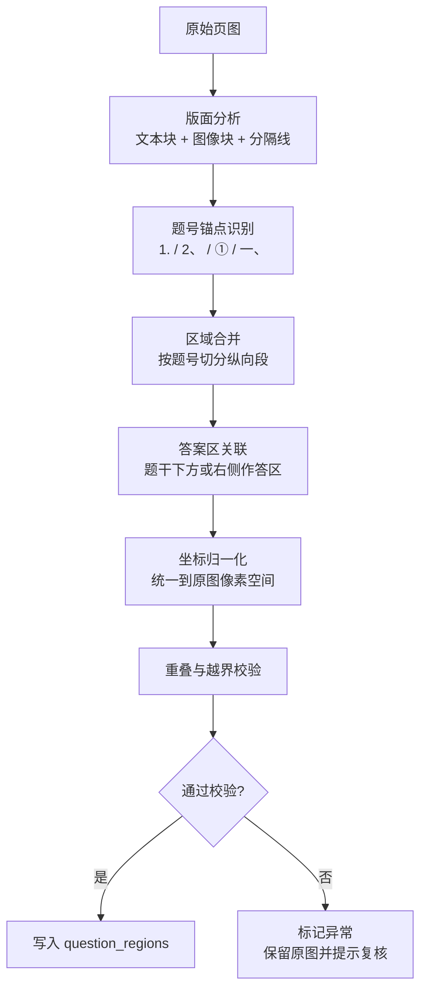
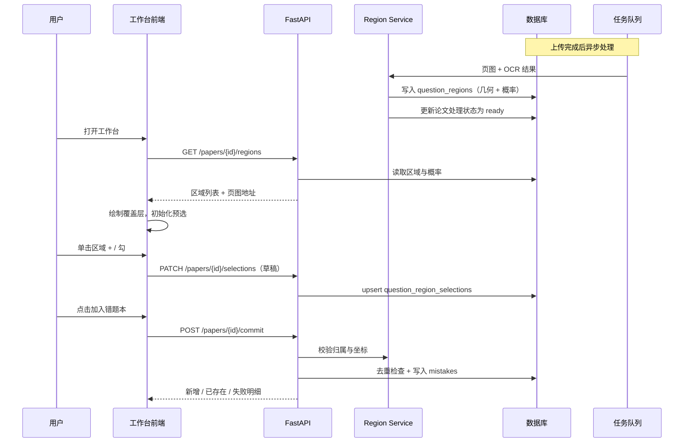

# MistakeBook AI 架构设计

| 文档项 | 内容 |
| --- | --- |
| 文档版本 | 0.2（V1.1 增量基线） |
| 文档状态 | 依据 PRD V1.1 编写；待产品方评审 PRD 后定稿 |
| 说明 | 本文件在 V1.1 前尚不存在。此版本覆盖 V1.1 引入的 Question Region Engine 与工作台数据流，其余模块给出边界定义但不视为已完成设计 |
| 关联 | `PRD.md`、`RFC-001-Interactive-Mistake-Selection.md`、`Database.md` |

## 1. 设计原则

1. **推荐与事实分离**：AI 产出的是“信号”（区域、概率、分析），用户提交才产生“事实”（错题记录）。架构上以不同的写入路径保证这一点。
2. **长任务异步化**：OCR、切题、概率评估、AI 分析均可能耗时数十秒至数分钟，不得占用同步请求。
3. **提供方可替换**：OCR、AI、存储、身份均通过接口隔离，避免把单一厂商写进业务逻辑。
4. **可自托管优先**：默认 SQLite + 本地存储可单机运行；PostgreSQL、MinIO、NAS 目录为可选增强。
5. **不可信输入**：上传文件、客户端提交的坐标与选择状态一律视为不可信。

## 2. 逻辑分层

分层遵循 Clean Architecture 的依赖方向：`API → Domain → Infrastructure`，领域层不依赖具体框架、ORM 或厂商 SDK。

## 3. 部署拓扑（目标形态）

首期为单体应用 + 独立任务执行进程，不引入消息中间件。任务队列在 SQLite 场景使用数据库表实现，PostgreSQL 场景可平滑替换为 SKIP LOCKED 轮询。微服务拆分不在首期范围。

## 4. 模块边界

| 模块 | 职责 | 明确不做 |
| --- | --- | --- |
| 认证与权限 | 会话、角色、家庭空间边界 | 不处理业务数据语义 |
| 文件与试卷 | 上传校验、页图生成、存储适配 | 不做 OCR 或切题 |
| 区域与确认 | 区域读写、概率分档、选择草稿、批量收录 | 不生成题目正文分析 |
| 错题与复习 | 错题 CRUD、筛选、复习计划 | 不直接调用 OCR |
| AI 与练习 | 分析、错因、出题、相似度 | 不决定是否收录 |
| 去重 | 相似度计算与归并建议 | 不静默删除数据 |

## 5. Question Region Engine

### 5.1 职责

把 OCR 与页面分析结果转换成前端可直接绘制的题目区域，并保证坐标稳定可追溯。它只负责“题目在哪里”，不负责“这道题该不该收录”。

### 5.2 处理管线

### 5.3 坐标契约

- 存储坐标系：**原图像素**，原点左上，`x`、`y` 为区域左上角。
- 显示坐标系：前端根据缩放比与平移量做线性变换，**不得回写**变换后的值。
- 生成页图时记录 `page_width`、`page_height` 与 `render_dpi`，用于核对坐标是否落在页面内。
- 服务端在收录请求中校验 `0 <= x`、`0 <= y`、`width > 0`、`height > 0` 且 `x + width <= page_width`。

### 5.4 与概率评估的边界

区域引擎输出几何信息；概率评估独立产出 `wrong_probability`。两者以 `question_region_id` 关联，但**分开计算**，使得：

- 区域检测失败时仍可降级为“无坐标候选”，不阻塞后续；
- 概率模型可单独替换或重新评估，不需要重跑切题。

### 5.5 失败与降级

| 情况 | 行为 |
| --- | --- |
| 版面分析无文本块 | 返回“未检测到题目”，不生成伪区域 |
| 只识别到部分题号 | 生成已知区域并标记 `incomplete`，提示人工复核 |
| 区域大面积重叠 | 保留但标记异常，UI 提示逐题核对 |
| 坐标越界 | 拒绝写入，记录诊断日志 |
| 概率计算失败 | 概率置空，UI 按普通题处理，用户仍可选择 |

## 6. 工作台数据流

设计要点：

1. 草稿选择单独持久化，刷新或会话过期后可恢复。
2. 提交是唯一产生 `mistakes` 记录的路径。
3. 提交返回逐题结果，支持部分成功与重试，不做全有或全无的静默回滚。
4. 去重在提交时重新计算，不使用客户端传入的“已存在”标记。

## 7. 关键接口约定（草案）

| 方法 | 路径 | 说明 |
| --- | --- | --- |
| `GET` | `/api/v1/papers/{paper_id}/regions` | 返回区域、概率、页图尺寸与图片访问地址 |
| `PATCH` | `/api/v1/papers/{paper_id}/selections` | 保存选择草稿（区域 id + 选中态） |
| `POST` | `/api/v1/papers/{paper_id}/commit` | 提交收录，返回新增/已存在/失败明细 |
| `POST` | `/api/v1/papers/{paper_id}/regions/{region_id}/reanalyze` | 重新识别单个区域 |

接口返回同时携带 `wrong_probability` 与 `band`（`recommended` / `suspected` / `normal`），避免前端重复实现阈值逻辑而出现前后端不一致。

## 8. 非功能约束

- **幂等**：`commit` 需支持幂等键，重复提交不产生重复错题。
- **并发**：同一用户对同一试卷的草稿写入按最后写入生效；不同用户互不影响。
- **性能**：区域查询分页或按页返回；单页区域数以配置上限约束。
- **可观测**：记录区域检测耗时、概率分分布、提交成功率与失败原因分类。
- **无状态应用**：应用进程不保存会话状态，便于水平扩展与重启恢复。

## 9. 风险与待决

| 项 | 说明 |
| --- | --- |
| 坐标存储格式 | 当前定为原图像素；是否增加归一化比例字段以适配 DPI 变化待定 |
| 区域上限 | 单页多少区域后需要降级渲染，需实测 |
| 概率模型 | 首期可用规则 + 轻量模型组合，是否引入独立模型服务待定 |
| 手工编辑区域 | 拆分/合并区域是否首期支持待产品确认 |
| 任务队列存储 | SQLite 表实现还是引入 Redis/RQ，取决于部署目标 |

## 10. V1.1 架构 Review

- 已确认：Question Region Engine 职责单一，坐标契约明确，草稿与正式记录写入路径分离，接口返回档位以避免前后端阈值重复实现。
- 已确认：所有长任务异步化，未引入首期不需要的中间件。
- 待确认：坐标存储格式、区域上限、概率评估实现方式、队列选型。
- 结论：**架构增量部分内部一致，可作为数据库与 UI 设计输入；不视为最终架构定稿。**
