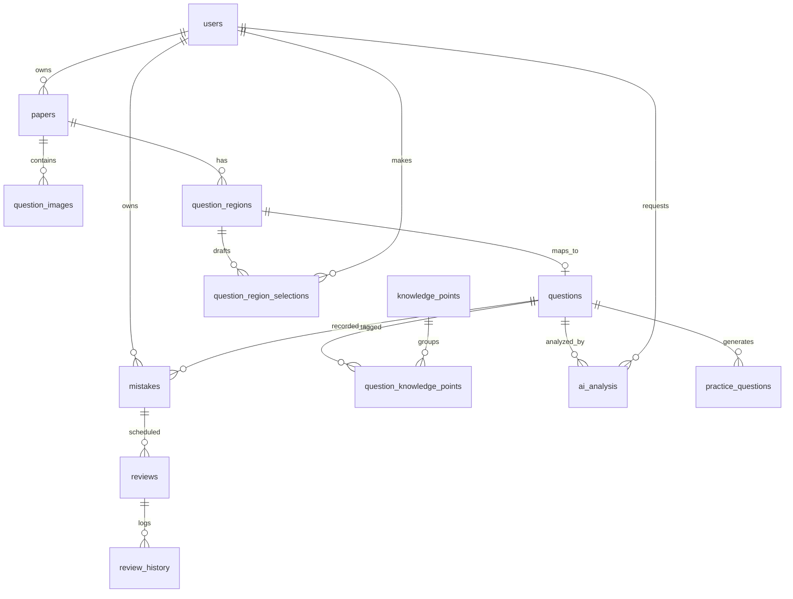
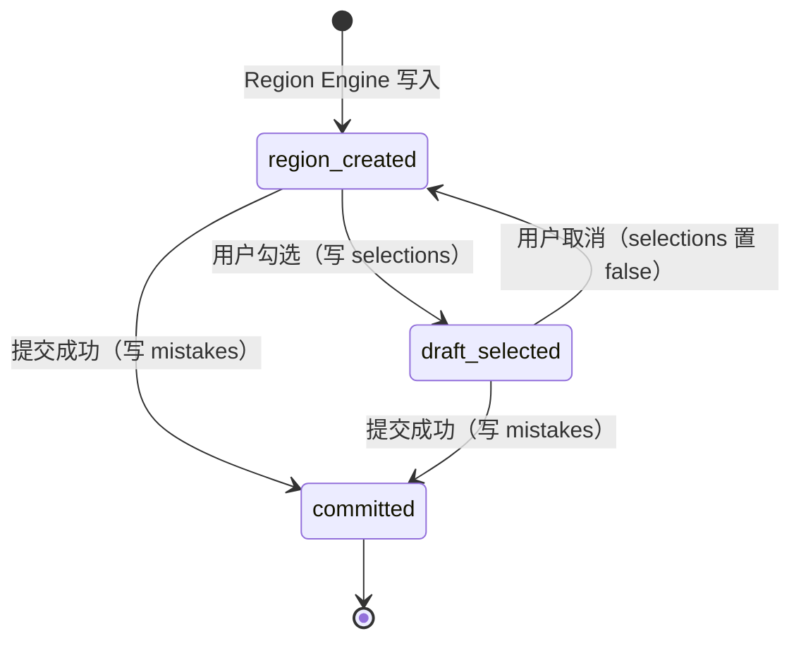

# MistakeBook AI 数据库设计

| 文档项 | 内容 |
| --- | --- |
| 文档版本 | 0.2（V1.1 增量基线） |
| 文档状态 | 依据 PRD V1.1 编写；待产品方评审 PRD 后定稿 |
| 说明 | 本文件在 V1.1 前不存在。本版聚焦 `question_regions` 及其选择状态建模，其余表按 PRD 要求给出结构但不视为已完成设计 |
| 关联 | `PRD.md` 第 5.7 节、`Architecture.md` 第 5 节、`RFC-001` |

## 1. 存储选型

- 默认 SQLite：单实例、零运维，适合家庭 NAS。
- 生产 PostgreSQL：并发写入与索引能力更强。
- 设计约束：不依赖 SQLite 独有语法；自增主键使用整型或 UUID 均可，但需上下一致；时间字段统一 UTC。

## 2. ER 图（核心实体）



## 3. 表定义（V1.1 相关部分）

### 3.1 `papers`（试卷）

| 列 | 类型 | 说明 |
| --- | --- | --- |
| id | PK | 试卷标识 |
| user_id | FK → users.id | 归属用户，权限校验起点 |
| title | text | 试卷名称 |
| subject | text | 学科，可由 AI 建议、用户修正 |
| source_type | text | `image` / `pdf` |
| status | text | `uploaded` / `processing` / `ready` / `failed` |
| page_count | int | 页数 |
| created_at / updated_at | timestamp | UTC |

索引：`(user_id, created_at desc)`、`(user_id, status)`。

### 3.2 `question_images`（页图与派生图）

| 列 | 类型 | 说明 |
| --- | --- | --- |
| id | PK | |
| paper_id | FK → papers.id | |
| page_no | int | 从 1 开始 |
| storage_key | text | 存储适配器内的对象键 |
| width | int | 原图像素宽 |
| height | int | 原图像素高 |
| render_dpi | int | 生成页图时使用的 DPI |
| crop_regions | json | 可选，派生裁剪图坐标引用 |

唯一约束：`(paper_id, page_no)`。

> `width` / `height` 是**坐标校验的基准**。区域坐标必须落在该范围内，服务端在收录时校验。

### 3.3 `question_regions`（题目区域，核心新增表）

| 列 | 类型 | 说明 |
| --- | --- | --- |
| id | PK | |
| paper_id | FK → papers.id，ON DELETE CASCADE | 所属试卷 |
| question_id | FK → questions.id，可空 | 与题目记录的关联；识别阶段可尚未建立 |
| question_image_id | FK → question_images.id | 定位到具体页 |
| page_no | int | 冗余但便于按页查询与校验 |
| x | int | 原图像素坐标，左上原点 |
| y | int | 同上 |
| width | int | 必须 > 0 |
| height | int | 必须 > 0 |
| region_order | int | 页面内顺序，用于稳定渲染与键盘焦点顺序 |
| wrong_probability | smallint | 0–100，可空（评估失败） |
| band | text | 由概率派生：`recommended` / `suspected` / `normal` / `unknown` |
| detection_status | text | `ok` / `incomplete` / `overlap` / `invalid` |
| figures_json | text | 本题内插图的矩形列表（JSON，页面像素坐标），见 3.3.1 |
| created_at | timestamp | UTC |

**关于 `is_selected` 的设计决策（重要）**

变更请求给出的字段清单包含 `is_selected`。若把它直接作为本表列，会产生两个问题：

1. **多用户覆盖**：`question_regions` 是试卷识别产物，属于 `papers`；当一个家庭内多个账号访问同一试卷时，A 的预选会覆盖 B 的选择。
2. **语义混淆**：预选是界面草稿，收录是数据库事实。把两者塞进同一列会让“是否已加入错题本”这一关键问题无法准确回答。

因此拆分：

| 概念 | 落点 | 生命周期 |
| --- | --- | --- |
| 预选/选择草稿 | `question_region_selections` | 提交后可清理 |
| 正式收录事实 | `mistakes` | 持久，需显式删除 |
| 推荐强度 | `question_regions.wrong_probability` + `band` | 识别产物，重新分析可更新 |

若评审坚持保留单一 `is_selected` 列，则必须限定为“单用户实例”，并额外引入 `selected_by_user_id`；本文档不推荐该方案。

索引：

- `(paper_id, page_no, region_order)` — 按页渲染。
- `(question_id)` — 由题目反查区域。
- `(paper_id, band)` — “仅选 AI 推荐”的批量操作。

约束：

- `CHECK (wrong_probability IS NULL OR (wrong_probability >= 0 AND wrong_probability <= 100))`
- `CHECK (width > 0 AND height > 0 AND x >= 0 AND y >= 0)`
- 应用层校验 `x + width <= question_images.width`、`y + height <= question_images.height`（部分数据库不支持跨表 CHECK）。

#### 3.3.1 `figures_json`（题目插图矩形）

**题干永远是文字，只有插图是图片。** 整题截图无法重排、无法搜索，打印时也只能按拍照
分辨率输出，所以错题本不能把一道题存成一张图。可复用文字存 `questions.text`；真正无法
用文字表达的（装置图、电路、曲线、结构模型）才作为矩形单独裁出。

```json
{ "v": 2, "items": [ { "x": 413, "y": 378, "width": 91, "height": 89 } ] }
```

| 键 | 含义 |
| --- | --- |
| `v` | 检测算法版本。版本不符视为“尚未计算”，避免沿用旧算法的结果 |
| `items[].x/y/width/height` | 插图的矩形，**页面像素坐标**，与区域坐标同一坐标系 |
| `items[].labels` | 图内印刷文字（`t/x/y/w/h`）。它们会从题干文字里移除，并在导出时按原位重绘 |

关键约定：

- `figures_json = '[]'` 表示“已算过，本题没有插图”；
- 列缺失/为空/NULL 表示“尚未计算”，启动修复与 `repair-figures` 只处理这种行。

### 3.4 `question_region_selections`（选择草稿）

| 列 | 类型 | 说明 |
| --- | --- | --- |
| id | PK | |
| question_region_id | FK → question_regions.id，ON DELETE CASCADE | |
| user_id | FK → users.id，ON DELETE CASCADE | 选择归属人 |
| is_selected | boolean | 当前草稿选择态 |
| updated_at | timestamp | 最后修改时间 |
| client_revision | int | 可选，乐观并发控制 |

唯一约束：`(question_region_id, user_id)`。索引：`(user_id, updated_at)`。

说明：该表仅保存“本次确认会话的意图”。提交成功后可由后台任务清理，也可保留短周期用于“撤销提交”。二者择一需在实现阶段定案，但**不得**把它当作错题本事实来源。

### 3.5 `mistakes`（正式收录）

| 列 | 类型 | 说明 |
| --- | --- | --- |
| id | PK | |
| user_id | FK → users.id | 归属 |
| question_id | FK → questions.id | 题目 |
| paper_id | FK → papers.id | 来源试卷 |
| question_region_id | FK → question_regions.id，可空 | 来源区域，用于追溯 |
| question_image_key | text | **仅旧记录**：整题截图的存储键。新记录为空 |
| figures_json | text | 本题插图列表（`{"v","items"}`，见 3.3.1），打印时随题干重排 |
| selection_source | text | `user_explicit` / `ai_preselected_accepted` / `imported`，用于分析预选质量 |
| wrong_probability_snapshot | smallint | 收录时概率快照，避免后续重算改变历史 |
| wrong_count | int | 错误次数，默认 1 |
| status | text | `active` / `archived` |
| created_at / updated_at | timestamp | |

唯一约束：`(user_id, question_id)` — 同一用户同一题只保留一条错题记录，重复提交走 `wrong_count + 1` 或“已存在”分支。

索引：`(user_id, status, created_at desc)`、`(user_id, paper_id)`、`(question_id)`。

> `wrong_probability_snapshot` 与 `selection_source` 是 V1.1 新增：前者让历史统计不受模型调整影响，后者让后续能评估“85 预选”的实际准确率。

> `figures_json` 与 `question_image_key` 的关系：截图字段是**历史兼容**。旧版本把整题裁成
> 一张图；新版本只存文字 + 插图。启动时的修复会把旧记录转成新形态并清空截图引用（文件
> 保留在磁盘，便于回退）。判定“还需要修复”的条件正是
> `question_image_key != '' AND figures_json = '[]'`。

### 3.6 其余表（按 PRD 要求，结构从简）

`users`、`questions`、`knowledge_points`、`question_knowledge_points`、`reviews`、`review_history`、`ai_analysis`、`practice_questions`、`system_settings` 的完整字段留待完整数据库设计阶段。本版仅确认：

- `questions` 需区分“识别文本”与“用户修正后文本”，两者都保留。
- `ai_analysis` 需记录提供方与模型名，便于解释结果来源。
- `system_settings` 中密钥字段必须加密存储，不可明文。

## 4. 状态与约束一致性



不变式：

1. `mistakes` 存在 ⇔ 该题已收录。任何“预选”不得使该表出现记录。
2. `question_regions.wrong_probability` 变化不影响已存在的 `mistakes.wrong_probability_snapshot`。
3. 删除 `papers` 时级联删除区域与草稿；`mistakes` 是否级联需产品决策（默认保留并标记来源缺失）。

## 5. 索引与性能

| 查询场景 | 索引 |
| --- | --- |
| 工作台按页加载区域 | `question_regions(paper_id, page_no, region_order)` |
| 仅选 AI 推荐 | `question_regions(paper_id, band)` |
| 恢复草稿 | `question_region_selections(user_id, updated_at)` |
| 错题列表筛选 | `mistakes(user_id, status, created_at desc)` |
| 去重候选 | `questions` 上文本/图像指纹索引（待算法定案） |

批量提交使用单事务分批写入，避免 500 题规模下单事务过长；每批失败返回明细，不整体回滚已成功部分（或整体回滚，需在实现阶段择一并写入 API 契约）。

## 6. 迁移与兼容

- 变更前无实现代码，因此无既有数据迁移。
- 若未来从“自动收录”升级：需为 `mistakes` 增加来源标记，并提示用户复核自动收录记录。
- Alembic 迁移需可在 SQLite 与 PostgreSQL 上执行；禁止使用单边方言特性。

## 7. V1.1 数据库 Review

- 已确认：`question_regions` 字段覆盖变更请求（id、paper_id、question_id、x、y、width、height、wrong_probability、created_at），并补充 `band`、`detection_status`、`question_image_id`、`region_order`。
- 已确认：`is_selected` 的语义被拆分为草稿选择与正式收录，避免多用户覆盖与语义混淆。
- 已确认：唯一约束防止同一用户重复收录同一题。
- 待确认：`mistakes` 在试卷删除时的保留策略、提交事务的原子性口径、去重指纹算法。
- 结论：**增量模型内部一致，可作为开发输入；待产品方确认 PRD 后定稿。**
