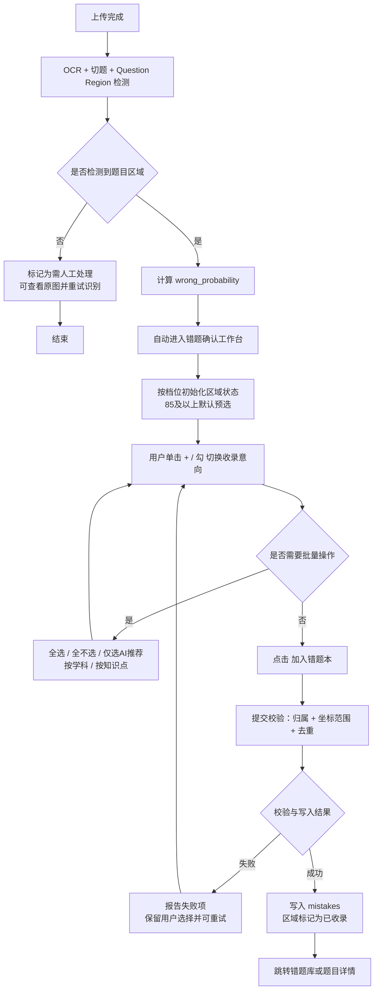
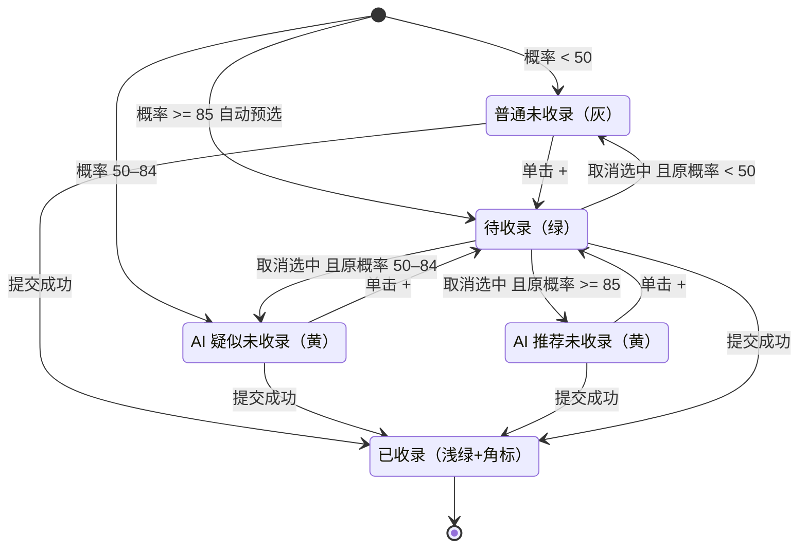
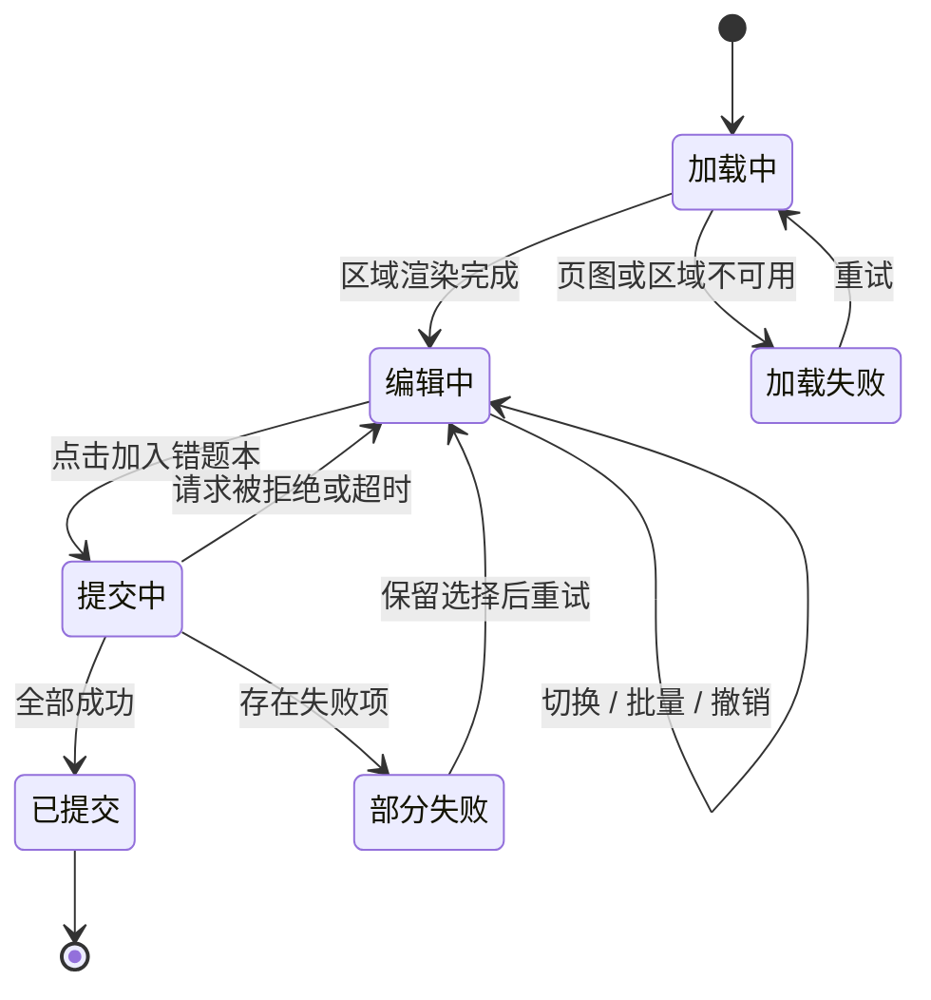

# MistakeBook AI 产品需求文档

| 文档项 | 内容 |
| --- | --- |
| 产品名称 | MistakeBook AI |
| 文档版本 | 1.1（V1.1 用户体验优化更新） |
| 文档状态 | V1.1 变更分析完成，待产品方评审 |
| 上一版本 | 0.1（Sprint 0 需求基线，内部 Review 通过） |
| 变更来源 | CR-001 交互式错题选择（`docs/RFC-001-Interactive-Mistake-Selection.md`） |
| 关联文档 | `docs/PRD-CHANGELOG.md` |
| 目标用户 | 学生及其家庭 |
| 目标交付形态 | 可自托管的 Web 应用 |

## 1. 产品概述

MistakeBook AI 是面向家庭学习场景的错题收集、分析和复习系统。学生或家长批量上传试卷照片或 PDF 后，系统识别页面内容、定位题目、估计批改结果并提供 AI 分析。用户在错题确认工作台的原试卷视图上审核候选题，明确加入后才正式进入错题本。系统进一步提供检索、复习计划、相似题练习、趋势统计与多格式导出。

核心产品原则：

- **AI 只推荐，用户做决定**：AI 负责 OCR、切题、错题概率评估、知识点与错因分析、相似题匹配；是否收录进错题本由用户决定。系统不得自动收录，也不得把“预选”当作“已收录”。
- **预选不等于收录**：`Wrong Probability Score >= 85` 只改变页面上区域的默认选中状态；写入数据库的唯一触发条件是用户在工作台点击“加入错题本”。
- **用户可覆盖 AI**：用户可以收录 AI 判定为正确的题目（例如收藏典型题），也可以忽略 AI 判定的错题；覆盖结果必须被保存，不被系统静默纠正。
- **用户确认后收录**：OCR、批改判断和 AI 分析均可能出错；自动识别结果属于候选内容，未经用户确认不得成为正式错题。
- **原始资料可追溯**：题目应能关联来源试卷、页码和裁剪图；分析结果应能被用户查看和修正。
- **家庭可自托管**：支持 Docker Compose 部署和持久化存储，兼顾常见 NAS 与 Windows Docker Desktop 环境。
- **逐步开放能力**：OCR、模型、存储和身份登录均允许配置或替换，未配置第三方服务时应提供清晰的不可用状态，而非静默失败。

## 2. 背景与问题

纸质错题通常散落在不同试卷、练习册和照片中，整理成本高，题目与知识点、错误原因及后续复习脱节。家庭难以持续回答三个问题：错在哪里、哪些知识点反复薄弱、接下来应该复习什么。

MistakeBook AI 通过“导入资料 → 识别候选 → 人工确认 → 归档分析 → 计划复习 → 回看效果”的闭环降低整理成本，并保留人工判断权。

## 3. 产品目标与非目标

### 3.1 目标

1. 将批量纸质资料转换成可审核、可检索的题目和错题记录。
2. 降低错题整理和知识点归类的人工成本，同时允许用户纠正识别结果。
3. 建立可执行的复习计划，并用历史表现帮助用户发现持续薄弱项。
4. 在可自托管环境中安全管理家庭学习资料，并让用户控制外部 AI 服务的使用。

### 3.2 非目标（首期）

- 不承诺 OCR 或 AI 对所有学科、字体、手写内容和复杂公式达到无误识别。
- 不在未审核情况下自动将识别题目加入正式错题本。
- 不提供在线课堂、实时视频教学、社交社区或学校班级管理。
- 不将系统定位为云端 SaaS；远程访问、云同步和多家庭租户能力需单独评估。
- 不在首期实现自训练 OCR 模型或自建基础大模型。

## 4. 用户与主要场景

### 4.1 用户角色

| 角色 | 主要诉求 | 典型权限/行为 |
| --- | --- | --- |
| 学生 | 快速整理错题、理解错误、按计划复习 | 上传、审核候选、编辑题目、练习、查看个人统计 |
| 家长 | 协助整理资料、了解学习趋势 | 管理家庭学习内容、查看统计、配置家庭级设置 |
| 系统管理员（自托管实例） | 管理实例、账号和集成配置 | 管理系统设置、存储、模型/OCR 提供方及备份 |

家庭成员之间的数据可见性与账号角色模型尚未定案，见“待决问题”。

### 4.2 核心用户旅程

1. 用户登录并选择或创建学习者空间。
2. 用户上传一批图片或 PDF，查看文件校验结果和处理进度。
3. 系统逐页执行 OCR、题目区域检测（Question Region）和批改标记判断，生成区域坐标、识别文本与错题概率分（0–100）。
4. 系统自动进入错题确认工作台，在原页图上绘制题目区域；概率 `>= 85` 的区域默认预选。
5. 用户直接在页图上单击区域中心的 `+` / `✓` 切换收录意向，可使用批量操作，也可修正识别文本与批改判断。
6. 用户点击“加入错题本”；系统先展示“已选择 / 预计新增 / 已存在”，确认后执行去重并写入。
7. 系统生成或补充 AI 分析；用户可以修改学科、知识点、难度和错误原因。
8. 用户在错题本中筛选、查看题目详情、安排复习、生成练习或导出。

## 5. 功能需求

优先级定义：P0 = 首个可用版本必需；P1 = 主要工作流完善；P2 = 后续增强。

### 5.1 账号与家庭空间

| ID | 优先级 | 需求 | 验收标准 |
| --- | --- | --- | --- |
| ACC-01 | P0 | 支持本地账号注册、登录和退出 | 用户可使用本地凭据创建账号并登录；错误凭据不泄露账号敏感信息；会话可退出 |
| ACC-02 | P1 | 预留 Microsoft、Google、微信身份登录 | 每个已启用提供方可完成授权、回调、账号关联和退出；未配置时不展示可用入口 |
| ACC-03 | P1 | 支持家庭成员/学习者边界 | 用户只能访问授权家庭空间的数据；成员角色与监护关系按确认后的权限模型执行 |
| ACC-04 | P0 | 提供个人偏好和系统设置入口 | 用户可查看并更新允许其管理的设置；敏感配置不以明文回显 |

### 5.2 上传与文件管理

| ID | 优先级 | 需求 | 验收标准 |
| --- | --- | --- | --- |
| UP-01 | P0 | 批量上传 JPG、JPEG、PNG、WEBP 和 PDF | 单批 1–500 个文件；界面显示逐文件状态及成功/失败原因 |
| UP-02 | P0 | 校验文件类型、大小、页数和可读性 | 不接受超出配置限制或无法解析的文件；拒绝原因可理解；无效文件不进入处理队列 |
| UP-03 | P0 | 展示处理进度并支持失败重试 | 用户可看到排队、处理中、完成和失败状态；重试不重复创建已成功结果 |
| UP-04 | P1 | 支持本地存储、NAS 共享目录和 MinIO 配置 | 管理员配置并验证存储后，上传和读取均可工作；实例重启后文件仍可访问 |
| UP-05 | P1 | 管理原始文件及其派生页图/裁剪图 | 每个派生内容可追溯到源文件与页码；按权限访问和删除 |

### 5.3 OCR 与题目识别

| ID | 优先级 | 需求 | 验收标准 |
| --- | --- | --- | --- |
| OCR-01 | P0 | 通过可替换的 OCR 能力识别中文、英文和常见数学表达 | 对受支持文件生成识别文本；无法识别的页面有明确状态，不伪造结果 |
| OCR-02 | P0 | 首选 PaddleOCR，并为 MinerU、OCRmyPDF 等提供扩展接入能力 | 管理员可选择已配置且健康的提供方；提供方不可用时有可诊断错误 |
| OCR-03 | P0 | 将页面切分为题目候选（Question Region），识别题号、题干区域和答案/作答区域 | 每个候选返回 `x`、`y`、`width`、`height`、页码、识别文字和来源关联；坐标可稳定映射回原图；区域缺失或重叠异常须标记复核 |
| OCR-04 | P0 | 识别批改痕迹：√、✓、✔、×、✗、△、○、问号、红笔标注、仅写分数等形式 | 输出 0–100 的 `wrong_probability` 与判定依据；`>=85` 默认预选、`50–84` 疑似、`<50` 普通；结果仅为推荐，必须可由用户推翻 |
| OCR-05 | P1 | 允许用户纠正 OCR 文本、切题边界和批改判断 | 修改可保存并反映在后续归档和导出结果；原始图像保持可查看 |

### 5.4 错题确认与错题库

| ID | 优先级 | 需求 | 验收标准 |
| --- | --- | --- | --- |
| MIS-01 | P0 | 提供错题确认中心 | 可查看识别候选、原图、识别文本和判断结果；候选不会自动进入正式错题库 |
| MIS-02 | P0 | 支持全选、反选、单选、排除和批量加入 | 选择状态清晰；只有用户明确提交加入的题目才被收录 |
| MIS-03 | P0 | 提供错题列表、详情和编辑 | 可按学科、知识点、时间、难度和错误次数筛选；详情展示来源和历史复习记录 |
| MIS-04 | P1 | 相似题去重与合并建议 | 相似度超过配置阈值（默认 90%）时提示疑似重复；用户可以确认合并或保留为独立题目；不得静默丢弃内容 |
| MIS-05 | P1 | 维护知识点目录和题目关联 | 用户可浏览知识点并查看相关错题；题目可关联一个或多个知识点 |
| MIS-06 | P1 | 导出 PDF、Word、Markdown 和 Obsidian 可用格式 | 用户可以选择题目范围和字段；导出文件可打开，文本和图片关系正确 |
| MIS-07 | P0 | 提供错题确认工作台，OCR 与切题完成后自动进入 | 按试卷页展示可缩放页图并叠加全部题目区域；详见第 5.7 节 |
| MIS-08 | P0 | 错题确认以图片直接操作为主交互 | 主视图不出现列表勾选；不得以列表作为唯一入口 |
| MIS-09 | P0 | 每个题目区域支持单击切换收录意向 | 单击 `+` 变 `✓` 并进入待收录；再次单击恢复 `+`；全程无弹窗 |
| MIS-10 | P0 | 提供全选、全不选、仅选 AI 推荐、按学科、按知识点批量操作 | 批量操作只作用于当前可见筛选范围；执行后逐区域状态与计数一致；支持撤销 |
| MIS-11 | P0 | 提交前展示“已选择 / 预计新增 / 已存在” | 计数与当前选择实时一致；点击“加入错题本”后才写入；失败须报告且不产生不可解释的部分收录 |

### 5.5 AI 分析与练习

| ID | 优先级 | 需求 | 验收标准 |
| --- | --- | --- | --- |
| AI-01 | P1 | 支持 OpenAI、GLM、DeepSeek 提供方配置 | 仅使用管理员显式配置的提供方；调用失败时展示可理解状态，不阻塞已保存错题 |
| AI-02 | P1 | 分析学科、知识点、难度、错误原因、正确解法和步骤 | 结构化结果可查看、编辑和重新生成；不确定或缺少上下文时标注，而非编造确定结论 |
| AI-03 | P1 | 支持错误原因类别和用户修正 | 至少覆盖计算错误、审题错误、概念错误、公式错误、知识点欠缺；用户可修改分类 |
| AI-04 | P1 | 根据历史错题生成 5、10 或 20 道同类型练习题 | 用户选择数量和范围后可生成；题目与答案/解析关联；生成失败时保留原始错题 |
| AI-05 | P1 | 对发送至外部模型的数据提供可见性和配置控制 | 用户/管理员可知调用的提供方；密钥不可在界面明文展示；不应把无关个人资料附加到请求 |

### 5.6 复习、统计和导出

| ID | 优先级 | 需求 | 验收标准 |
| --- | --- | --- | --- |
| REV-01 | P1 | 按间隔复习策略生成今日、本周和本月复习列表 | 到期题目按计划出现；用户完成、跳过或调整后，计划状态同步更新 |
| REV-02 | P1 | 记录复习历史 | 每次复习关联题目、时间和用户反馈；历史可在题目详情中查看 |
| ANA-01 | P1 | 提供错误原因、知识点和时间趋势统计 | 统计口径与筛选范围明确；无数据时显示空状态而非误导性图表 |
| ANA-02 | P2 | 展示错因和知识点趋势分析 | 趋势有明确时间范围和样本量；小样本时提示结论局限 |
| EXP-01 | P1 | 提供 PDF、Word、Markdown、Obsidian 导出 | 导出内容包括所选题目及可选分析字段；导出权限和文件访问符合账号边界 |

### 5.7 错题确认工作台（Mistake Confirmation Workspace）

#### 5.7.1 定位

工作台是 OCR 与切题完成后的**必经确认环节**，也是错题本唯一的正式入口。它取代列表勾选式确认，让用户直接在原试卷页图上完成“哪道题进错题本”的决策。

硬性约束：

1. 主交互为图片直接操作；`□题目1 / □题目2` 形式的列表勾选不得作为主要或唯一入口。
2. 单击切换，全程无弹窗。
3. 不自动收录。任何“预选”都只是编辑草稿，不是数据库记录。
4. 进入工作台的题目状态必须一眼可辨。

#### 5.7.2 功能说明

| 功能 | 说明 |
| --- | --- |
| 页图视图 | 按试卷页展示原图，支持缩放、平移、适应宽度；保留原始分辨率用于核对 |
| 区域覆盖层 | 在页图上按 `Question Region` 坐标绘制半透明边框与遮罩，不遮挡题干文字 |
| 状态按钮 | 每个区域中心显示 `+`（未收录）或 `✓`（待收录）；单击切换，无弹窗 |
| 概率徽标 | 显示 `wrong_probability`（0–100）与档位：`>=85` 推荐、`50–84` 疑似、`<50` 普通 |
| 文本浮层 | 悬停/聚焦区域时显示题号、概率、识别文本摘要与批改依据；仅浮层，不弹窗 |
| 批量操作 | 全选、全不选、仅选 AI 推荐、按学科、按知识点；作用于当前筛选可见范围 |
| 计数条 | 右下角固定显示“已选择 / 预计新增 / 已存在”，随选择实时更新 |
| 提交 | 点击“加入错题本”后统一校验并写入；提交前不产生正式错题记录 |
| 撤销 | 支持撤销上一次切换及上一次批量操作；批量操作后提供短时撤销条 |
| 草稿恢复 | 意外刷新、切页或登录过期后恢复未提交的选择 |

#### 5.7.3 业务流程



#### 5.7.4 页面原型

```text
+-----------------------------------------------------------------------------+
| 试卷：数学 Unit 3 单元测       第 2 / 5 页    [适应宽度] [-] [100%] [+]     |
+-----------------------------------------------------------------------------+
|                                                                             |
|   +-----------------------------------+                                     |
|   | 1. 计算 12 x 8 的结果             |  <- 灰色边框：未收录，普通题        |
|   |                                   |     徽标 12  按钮 ( + )             |
|   |             ( + )                 |                                     |
|   +-----------------------------------+                                     |
|                                                                             |
|   +-----------------------------------+                                     |
|   | 2. 解方程 3x + 5 = 20             |  <- 黄色边框：未收录，疑似错题      |
|   |                                   |     徽标 62  按钮 ( + )             |
|   +-----------------------------------+                                     |
|                                                                             |
|   +-----------------------------------+                                     |
|   | 3. 化简 (a+b)^2                   |  <- 绿色边框：待收录（已选中）      |
|   |                                   |     徽标 98  按钮 ( v )             |
|   |             ( v )                 |                                     |
|   +-----------------------------------+                                     |
|                                                                             |
+-----------------------------------------------------------------------------+
| 已选择：12 题    预计新增：9 题    已存在：3 题        [取消] [加入错题本]  |
+-----------------------------------------------------------------------------+
```

边框颜色为单通道，按固定优先级取值，同一区域任一时刻只有一种含义：

| 优先级 | 视觉 | 含义 |
| --- | --- | --- |
| 1（最高） | 浅绿填充 + “已收录”角标 | 已写入错题本，按钮不可再切换 |
| 2 | 绿色边框 | 本次待收录（用户已选中，含 `>=85` 的默认预选） |
| 3 | 黄色边框 | 未收录，且 AI 认为可能错（`>=85` 推荐或 `50–84` 疑似） |
| 4（最低） | 灰色边框 | 未收录，且 AI 认为普通（`<50`） |

因此不存在颜色冲突：`wrong_probability >= 85` 的区域初始为**绿色边框**（因为已默认预选，优先级 2 高于优先级 3）；用户取消选中后降为**黄色边框**（优先级 3）。每个区域另有一个概率徽标显示具体分值（0–100），供用户判断推荐强度，徽标不参与边框优先级计算。

#### 5.7.5 状态转换图

区域级状态（单题）：



说明：“已收录”只能由提交成功到达；取消选中回到该区域原本的 AI 档位，概率值不变。注意 `>=85` 的初始状态是“待收录（绿）”，不是“AI 推荐未收录（黄）”——后者只在用户主动取消后出现。

会话级状态（工作台）：



#### 5.7.6 用户交互说明

| 用户动作 | 系统响应 | 约束 |
| --- | --- | --- |
| 单击区域中心 `+` | 变为 `✓`，边框转绿，计数 +1，该题进入待收录列表 | 单击完成，无二次确认弹窗 |
| 再次单击 `✓` | 恢复 `+`，边框回到该区域原 AI 档位色，计数 −1 | 概率值不变 |
| 悬停或聚焦区域 | 显示题号、概率、识别文本摘要、批改依据 | 浮层不遮挡按钮；可键盘聚焦 |
| 全选 / 全不选 | 对当前筛选可见区域批量设置 | 不影响被筛选隐藏的区域；批量后可撤销 |
| 仅选 AI 推荐 | 仅选中 `>=85` 区域，其余取消 | 等价于“重置为 AI 预选” |
| 按学科 / 按知识点选择 | 在可见范围内按条件批量选中 | 学科/知识点为 AI 分析结果，用户可先修正 |
| 缩放 / 平移 | 仅改变视图变换 | 不改写存储坐标 |
| 键盘 `Space` / `Enter` | 切换当前聚焦区域状态 | 焦点顺序按区域在页面中的位置 |
| `Ctrl+Z` | 撤销上一次切换或批量操作 | 撤销栈至少回退一次批量操作 |
| 点击“加入错题本” | 展示提交摘要，成功后跳转错题库 | 提交为唯一写入动作 |

#### 5.7.7 异常场景处理

| 场景 | 处理方式 |
| --- | --- |
| 未检测到题目区域 | 不进入可编辑状态；提示原因、提供原图查看与重新识别，不生成伪题目 |
| 区域重叠或越界 | 标记为异常区域并要求复核；提交前拒绝越界坐标 |
| `wrong_probability` 计算失败 | 显示“未评估”，按灰色普通题处理，用户仍可手动选中 |
| 页图加载失败 | 允许重试并降级到缩略图网格；降级视图仅作应急，不作为默认交互 |
| 识别文本为空但区域存在 | 保留区域并可收录，提示需人工补充题目内容 |
| 提交时发现已存在相同题目 | 计入“已存在”，默认不重复收录，用户可显式选择仍要收录 |
| 提交部分失败 | 报告失败条目与原因，保留用户全部选择，可重试；不得静默丢弃 |
| 会话过期或页面刷新 | 恢复未提交草稿；恢复失败时明确告知并保留只读快照 |
| 500 个文件的批次 | 按页/按批次分组进入工作台，区域按需渲染，避免一次性绘制全部 |
| 用户误点 | 提供即时撤销入口与短时撤销条 |

#### 5.7.8 验收标准

1. Given OCR 与切题成功，When 处理完成，Then 系统自动进入工作台并在页图上绘制全部题目区域。
2. Given 工作台已加载，When 用户查看主视图，Then 不存在列表勾选作为唯一交互方式。
3. Given 某区域 `wrong_probability = 98`，When 工作台初始化，Then 该区域为绿色边框、`✓` 状态，并计入“已选择”。
4. Given 某区域 `wrong_probability = 62`，When 工作台初始化，Then 该区域为黄色边框、`+` 状态，不计入“已选择”。
5. Given 某区域为 `+`，When 用户单击一次，Then 变为 `✓` 且无弹窗；再次单击恢复 `+`。
6. Given 用户已选择若干题，When 尚未点击“加入错题本”，Then 数据库中不存在这些题目的收录记录。
7. Given 用户点击“加入错题本”，When 写入成功，Then 计数与错题库记录一致，区域状态变为“已收录”。
8. Given 提交中部分失败，When 系统返回结果，Then 展示失败项，用户选择仍保留可重试。
9. Given 选择中包含已存在题目，When 展示计数条，Then 该题计入“已存在”而非“预计新增”。
10. Given 页图缩放至 50% 或 200%，When 用户切换区域状态，Then 提交的坐标与原图一致。

### 5.8 页面范围

首期信息架构包含以下页面或等价视图：

1. 登录页
2. 首页仪表盘
3. 上传中心
4. OCR 结果页
5. 错题确认工作台（Mistake Confirmation Workspace，替代原“错题确认页”）
6. 错题库页
7. 题目详情页
8. 知识点页
9. AI 练习页
10. 复习计划页
11. 数据统计页
12. 用户设置页

## 6. 业务规则

1. 上传成功不等于题目识别成功；每个阶段均应有独立状态和失败原因。
2. 识别结果按“正确、错误、疑似错误、未判断”区分；“疑似错误”不能隐式等同于错题。
3. 用户确认是错题正式收录的唯一默认入口。批量操作必须让用户在提交前看到选择数量。
4. 相似度 90% 是默认去重提示阈值，不是不可逆删除规则；实际归并应保留来源和用户可追溯性。
5. AI 输出是辅助建议。用户可纠正分类和分析；AI 调用不可用不得影响基本浏览、编辑和复习。
6. 删除题目、来源试卷或账号时，关联文件、历史和导出数据的保留规则需要在隐私/删除策略中明确。
7. 不同 OCR/AI/存储提供方之间的能力可能不同，产品需展示当前可用功能和配置状态。
8. `wrong_probability` 是推荐信号而非事实：`>= 85` 仅触发默认预选，`50–84` 标记疑似，`< 50` 视为普通题；三档均可被用户一键推翻。
9. 预选状态属于本次确认会话的编辑草稿，不得在提交前写入正式错题数据；刷新或返回后草稿应可恢复。
10. 边框颜色按“已收录 > 待收录 > AI 可能错 > 普通”的固定优先级取单一值，不得由不同规则并发设置；概率分值以徽标展示，不参与边框颜色决策。
11. 已存在题目的判定必须在提交时重新计算并展示，用户不得在不知情的情况下产生重复收录。
12. 每道题目区域必须可追溯到 `paper_id` + 页码 + 坐标；坐标以原图像素为基准，缩放显示不得改变存储值。
13. 选择状态按确认人隔离，不得跨用户或跨家庭共享（见 `docs/Database.md`）。

## 7. 非功能需求

### 7.1 部署与兼容性

- 提供 Docker Compose 自托管部署方式，目标环境包括 Linux、群晖、威联通、绿联、极空间及 Windows Docker Desktop。
- 提供 SQLite 默认运行配置；生产部署支持 PostgreSQL。
- 容器数据和上传文件必须位于可持久化卷或用户配置的存储位置，容器重建不应导致数据丢失。
- NAS 兼容性依赖 NAS 型号、CPU 架构、容器运行时、目录权限和可用内存；在目标设备上须做实际验证后才能宣称已认证支持。
- 支持通过环境变量或管理界面配置部署参数；不得要求用户把密钥提交到版本库。

### 7.2 性能与容量

- 上传工作流支持单批最多 500 个文件；前端应分批/异步提交并提供进度反馈，服务端对并发和资源使用实施配置限制。
- OCR 和 AI 属于耗时任务，应异步处理并可查询状态；服务不可用或任务失败不得导致请求无限挂起。
- 具体单文件大小、PDF 页数、并发任务、保留容量和响应时间 SLO 在目标硬件测量后确定，不在本 PRD 中虚构固定值。
- 列表检索和统计应支持分页及明确筛选条件，避免一次加载完整家庭资料。
- 工作台在单页区域数量较多时仍须保持可交互：页图按需加载，区域以覆盖层绘制，不得因区域数量线性阻塞主线程；单页区域上限与渲染策略由架构阶段按实测确定。

### 7.3 可用性与可维护性

- 主要流程具备空、加载、成功、失败和部分成功状态；错误信息应指出可操作的下一步。
- 数据库升级、备份恢复和应用版本升级应有可重复的运维流程。
- 外部 OCR、AI、对象存储和身份提供方通过明确配置接入；提供方故障可观测且可替换。
- 关键任务应有结构化日志和健康状态；日志中不得记录密码、访问令牌、模型密钥或不必要的题目原文。

### 7.4 安全与隐私需求

- 所有业务对象均须校验用户/家庭空间授权，不能仅依赖前端隐藏控件。
- 上传文件须做内容校验、大小/页数限制和安全存储；不可将用户文件作为可执行内容直接服务。
- 防护认证、权限绕过、SQL 注入、XSS、CSRF（适用时）、恶意文件和不可信文档解析风险。
- 对提示词注入和文档内指令采取隔离策略：上传资料只作为待分析数据，不可覆盖系统指令、调用任意工具或改变授权策略。
- 第三方 AI 请求应遵循最小必要原则；需在产品中说明数据可能离开本地实例，并允许管理员禁用外部 AI。
- 题目区域坐标、`wrong_probability` 和选择状态均可能来自客户端，提交时须在服务端校验坐标边界、概率取值范围与题目归属，不得信任前端传入的 `is_selected`。
- 工作台提交接口必须逐题校验所属试卷归属，防止构造 `question_id` / `paper_id` 越权收录他人内容。
- 提供账号退出、数据导出和数据删除策略；具体保留期限、备份删除和未成年人数据处理要求需在发布前确认。

## 8. 首期范围与版本规划

| 版本/阶段 | 目标范围 |
| --- | --- |
| Sprint 0 | 需求分析、PRD 基线和 Review |
| Sprint 1 | 架构、数据库和 UI 设计；明确服务边界、接口约定和数据模型 |
| Sprint 2 | 本地账号、家庭/学习者权限基线、文件上传和处理状态 |
| Sprint 3 | OCR 接入、Question Region Engine、区域坐标与错题概率评估 |
| Sprint 4 | 错题确认工作台（图片直接操作）、错题库、题目详情和去重建议 |
| Sprint 5 | AI 分析、错误分类和练习题生成 |
| Sprint 6 | 复习计划、复习历史和统计分析 |
| Sprint 7 | 安全审计、质量测试、部署验证和首版发布 |

每个 Sprint 周期为 7 天。具体人力、验收环境和各 Sprint 交付承诺需在 Sprint Planning 时结合团队容量调整。外部登录、所有 NAS 型号兼容认证、多种 OCR/AI 提供方的生产级覆盖及高级导出格式可根据风险和资源分批交付，不应以未完成配置的入口冒充已支持功能。

## 9. 成功指标

首期通过可观测事件建立基线，之后再设定目标值：

- 上传批次完成率及文件级失败率。
- OCR 任务成功率、候选题人工修正率和批改判断确认/更改比例。
- 从上传到用户完成确认的时间，以及候选题加入率。
- 工作台效率：确认单题所需点击数、批量操作使用率、撤销率。
- 预选质量：`>=85` 预选项被保留的比例，以及被取消/补选的比例，用于校准阈值。
- 错题重复归并建议的接受率和误归并反馈数。
- 复习计划按期完成率、复习后用户反馈变化。
- AI 分析/出题成功率、用户编辑率和失败后恢复率。
- 部署升级成功率、备份恢复验证结果及安全问题关闭率。

在没有真实使用数据前，不以未经验证的识别准确率或学习效果数字作为产品承诺。

## 10. 验收基线

首个可用版本至少满足以下端到端验收：

1. 用户可在受支持部署中创建本地账号并登录。
2. 用户可上传受支持类型文件；单批上限为 500，超限或无效文件被明确拒绝。
3. 系统可处理至少一个已配置 OCR 提供方的任务，并为页面生成带来源关联的题目候选或明确失败状态。
4. 用户可审核、编辑、排除候选，并通过确认操作将选中题目加入错题本；未确认项不进入正式错题库。
5. 用户可查看错题、按首期筛选条件检索，并追溯到原始试卷页面。
6. AI 未配置或不可用时，错题的保存、查看和编辑仍可使用；配置后才开放相应 AI 能力。
7. 数据在应用容器重启后仍存在；使用部署文档可完成一次备份恢复演练。
8. 未授权用户不能读取其他账号/家庭的数据；发布前安全和测试阶段须覆盖上传、权限、输入校验及关键用户流程。
9. OCR 与切题完成后系统自动进入错题确认工作台，并在页图上绘制全部题目区域；每个区域可追溯到 `paper_id` 与坐标。
10. 工作台主视图为图片直接操作，不存在列表勾选作为唯一交互；单击区域按钮可无弹窗切换 `+` / `✓`。
11. `wrong_probability >= 85` 默认预选、`50–84` 疑似、`< 50` 普通；用户可推翻任意预选结果。
12. 点击“加入错题本”之前数据库无该批收录记录；提交成功后记录与计数一致。

## 11. 风险与依赖

| 风险/依赖 | 影响 | 应对方向 |
| --- | --- | --- |
| 试卷版式、手写答案和红笔标记差异大 | OCR、切题和对错判断质量不稳定 | 置信度/疑似状态、人工校正、代表性样本集评估 |
| 数学公式识别受引擎和图像质量影响 | AI 分析及题目检索结果可能错误 | 保留原图、展示识别文本、允许编辑；首期不承诺完美公式还原 |
| 500 文件批次造成 CPU、内存或存储峰值 | NAS 设备可能卡顿或任务积压 | 异步任务、限流、配置上限和低资源设备测试 |
| NAS 架构及目录权限差异 | 安装或文件持久化失败 | 提供通用 Compose 配置与权限排查说明，按具体设备验证兼容性 |
| 外部 AI/OCR 服务的数据处理与费用 | 隐私、成本和可用性风险 | 明确管理员配置和用户提示，允许禁用，提供调用失败状态 |
| 相似题误合并 | 用户资料或历史丢失 | 首期只建议归并，由用户确认并保留来源关系 |
| 多登录提供方涉及回调与账号关联复杂度 | 账号重复、接管或部署配置错误 | 本地账号先行；联邦登录逐提供方交付并进行关联安全测试 |
| 学校/地区批改习惯差异（√ ✓ ✔ × ✗ △ ○ 问号、仅写分数、红笔） | 错题概率分偏差，预选质量不稳定 | 预选仅作默认值且可一键推翻；按来源记录用户反馈用于校准 |
| 批量确认区域过多（500 文件批次） | 工作台卡顿、误点 | 按页分组渲染、批量操作限定可见范围、提供撤销 |
| 客户端提交坐标或选择状态被篡改 | 越权收录、区域错位 | 服务端校验归属与范围，不信任前端 `is_selected` |
| 用户误将“预选”理解为“已收录” | 漏收录或错收录 | 文案统一为“待收录”，绿色仅表示已选中，提交按钮显式措辞 |
| 未成年人及家庭数据隐私要求 | 可能影响发布地区和运营方式 | 发布前确认运营地区、隐私告知、删除/备份策略及适用法规 |

## 12. 假设与待决问题

当前需求足以建立 Sprint 0 基线，但以下事项需产品负责人在设计/发布相应功能前确认：

1. 首期是单用户实例还是支持一个家庭下多个学生与监护人？成员邀请、角色和跨成员可见性规则是什么？
2. 是否开放公网访问？是否需要反向代理、TLS、邮件验证、密码重置或多因素认证？
3. 用户数据默认仅本地处理，还是允许向管理员配置的第三方 OCR/AI 服务发送？上传者如何获得告知和同意？
4. 支持的最大单文件大小、PDF 页数、图片分辨率、任务并发及 NAS 最低硬件规格是多少？需通过目标设备测试确定。
5. 批改结果分类是否覆盖部分得分、订正后答案、老师批注和无明确符号的错误？首期可先按正确/错误/疑似/未判断落地。
6. 90% 相似度采用何种比较对象和合并字段？本 PRD 将其定义为建议阈值，确认算法与字段属于架构/设计阶段事项。
7. Ebbinghaus 复习间隔、用户反馈等级和调整规则采用何种默认方案？
8. 外部登录、微信登录、Word 导出、Obsidian 导出和各 NAS 品牌是否均为首版发布门槛，还是分阶段支持？
9. 数据保留、账号删除、备份保留、日志保留和 AI 提供方数据留存的具体政策是什么？
10. 首发语言、时区、地区法规及是否支持多语言是什么？当前以简体中文界面为默认假设。
11. `wrong_probability` 的 85 / 50 阈值是否固定，还是允许按学校、年级或学科配置？本文档以 85 / 50 为默认值。
12. 区域坐标以原图像素还是标准化比例存储？本文档以原图像素为基准，需架构阶段确认与 DPI/缩放的处理方式。
13. 用户手工调整区域边界（拆分/合并区域）是否属于首期？当前仅要求可修正识别文本与批改判断。

## 13. Sprint 0 Review

### Review 检查

- 覆盖用户目标、角色、核心旅程、功能范围和端到端验收基线。
- 明确自动识别结果必须经过用户确认才能收录，且低置信结果须可复核。
- 覆盖指定的上传格式/批量上限、OCR/切题、错题管理、AI、去重、复习、导出、部署与登录方向。
- 区分首期必需与后续能力，未把识别准确率、NAS 全型号兼容或学习效果作为未经验证的承诺。
- 记录权限、文件处理、第三方 AI 数据流、未成年人隐私和备份等关键风险。
- 将家庭权限、性能容量、复习算法、数据保留和首版范围列为待决事项。

### Review 结果

**内部 Review 通过，待产品方确认后放行 Sprint 1。** 本次 Review 确认需求文档结构完整、可作为后续设计输入；不代表待决问题已获业务确认，也不代表产品已发布。Sprint 1 尚未开始。产品方确认放行后，Sprint 1 应将相关假设显式映射到设计决策，并在影响数据权限、隐私或发布承诺的事项上先取得产品确认。

### 阶段交付

1. 当前阶段目标：建立统一、可验收的产品需求基线。
2. 已完成内容：产品目标、角色和旅程、功能需求、业务规则、非功能需求、版本规划、验收基线、风险与待决问题。
3. 风险项：OCR/红笔判断质量、NAS 资源差异、外部 AI 隐私、家庭数据权限和发布法规尚需验证/确认。
4. 待解决问题：见第 12 节；涉及权限和隐私的决策应在对应设计落定前解决。
5. Review 结果：通过，可作为下一阶段输入；待决项继续跟踪。
6. 下一阶段计划：产品方评审并放行后，Sprint 1 由架构、数据库和 UI 设计角色基于本 PRD 产出架构、ER/索引方案及页面交互稿，并进行阶段 Review。当前未开始 Sprint 1。

## 14. V1.1 变更审查（CR-001 交互式错题选择）

### 14.1 变更摘要

| 项 | V1.0 基线 | V1.1 |
| --- | --- | --- |
| AI 角色 | 判断错题并生成候选 | 切题、评估概率、推荐、分析；不决定收录 |
| 收录决策 | 用户确认，但确认方式未定义 | 用户在页图上单击决定，系统不得自动收录 |
| 确认界面 | “错题确认页”，未约束交互形态 | 错题确认工作台，图片直接操作为主交互，禁止列表勾选作为唯一入口 |
| 错题判定 | 分类为正确/错误/疑似 | 输出 0–100 概率分，按 85/50 分档 |
| 题目定位 | 区域坐标未作为交付物 | `Question Region`（x/y/width/height）为 P0 交付物 |
| 批量操作 | 全选、反选、单选 | 全选、全不选、仅选 AI 推荐、按学科、按知识点 |
| 提交前信息 | 选择数量 | 已选择 / 预计新增 / 已存在 三项计数 |

### 14.2 需求覆盖核对

| 变更请求条目 | 落点 |
| --- | --- |
| 核心原则由“AI 判断后自动收录”改为“AI 推荐 + 用户确认” | 1 节核心原则、4.2 旅程、第 6 节规则 8–10、RFC-001 |
| 错题确认工作台（OCR 后进入） | 5.7.1、5.7.3、MIS-07 |
| 图片直接操作模式，禁止列表勾选 | 5.7.1 硬性约束、MIS-08、5.7.4 |
| 题目区域自动识别与坐标 | OCR-03、5.7.2、Architecture 第 5 节、Database `question_regions` |
| 概率分 0–100 与 85/50 分档 | OCR-04、5.7.4、第 6 节规则 8 |
| 区域中心 `+` / `✓` 单击切换、无弹窗 | 5.7.6、MIS-09、UI 第 4 节 |
| 灰/黄/绿边框与“一眼可见已加入” | 5.7.4 颜色语义、第 6 节规则 10、UI 第 5 节 |
| 批量操作五种 | 5.7.6、MIS-10 |
| 右下角三项计数与提交写入 | 5.7.2、MIS-11、5.7.8 第 7–9 条 |
| 工作台完整章节（功能/流程/原型/状态图/交互/异常） | 5.7.1–5.7.8 全部小节 |
| UI 三张 Mermaid 图 | `docs/UI.md` 第 3–5 节 |
| Question Region Engine | `docs/Architecture.md` 第 5 节 |
| `question_regions` 表 | `docs/Database.md` 第 4 节 |
| PRD 变更记录 | `docs/PRD-CHANGELOG.md` |
| RFC 说明调整理由 | `docs/RFC-001-Interactive-Mistake-Selection.md` |

### 14.3 本次修订中消解的三处需求冲突

1. **颜色语义冲突**：原请求中“AI 推荐错题 = 黄色边框”与“已选中收录 = 绿色边框”会在 `>=85` 自动预选时同时命中。V1.1 定义优先级为 **已收录 > 待收录（绿） > 疑似未收录（黄） > 普通未收录（灰）**，AI 推荐程度改由概率徽标表达，两者不再互斥。
2. **`is_selected` 归属冲突**：把 `is_selected` 直接放在 `question_regions` 上会在多用户/多家庭下互相覆盖。V1.1 将“当前会话选择”与“正式收录记录”分离，详见 `docs/Database.md` 第 4.3 节。
3. **“预选”与“已收录”的措辞冲突**：统一为“待收录”，界面不出现“已加入错题本”字样，直到提交成功。

### 14.4 风险与待决

- 85/50 阈值为默认值，是否允许按学科/学校配置仍待确认（第 12 节第 11 条）。
- 区域坐标以原图像素为基准，DPI 与坐标标准化方案留给架构阶段。
- 手工拆分/合并题目区域暂不纳入首期。

### 14.5 Review 结果

**内部一致性 Review 通过，待产品方评审确认后方可进入架构实现。** 已确认：需求条目全部有唯一落点、术语统一、颜色与状态语义无歧义、验收标准可测试。未确认：阈值可配置性、坐标存储格式、区域编辑范围。本次变更不改变 Sprint 0 已定的产品目标与非目标，也不构成发布承诺。
