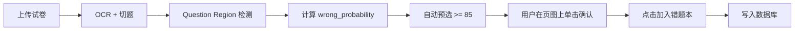

# RFC-001 交互式错题选择（AI 推荐 + 人工确认）

| 文档项 | 内容 |
| --- | --- |
| RFC 编号 | RFC-001 |
| 标题 | 从“AI 自动判断并收录错题”调整为“AI 推荐 + 用户在图片上确认” |
| 状态 | 提议（Proposed），待产品方评审 |
| 关联需求 | CR-001 / PRD V1.1 |
| 影响文档 | `PRD.md`、`Architecture.md`、`Database.md`、`UI.md`、`TestPlan.md`、`Security.md` |
| 决策级别 | 产品交互与数据模型变更（不改变产品目标） |

## 1. 摘要

将错题收录的最终决定权从 AI 转移到用户。AI 只输出 0–100 的错题概率分与题目区域坐标；用户在错题确认工作台中直接在原试卷图上单击选择，点击“加入错题本”后才写入数据库。

## 2. 背景

V1.0 的需求表述是“AI 判断错题 → 自动加入错题本”。产品评审认为该路径存在较高的误判风险，理由来自真实教学场景的多样性：

| 批改形式 | 说明 | 对自动判定的影响 |
| --- | --- | --- |
| `√` / `✓` / `✔` | 同一“正确”含义存在多种字形 | 字形集合不完备即漏判 |
| `×` / `✗` | 叉号笔画差异大，印刷与手写混用 | 易与字母 x、乘号混淆 |
| `△` | 常表示“部分正确”或“待订正” | 无统一语义，需人工解释 |
| `○` | 可能表示正确，也可能只是圈出题干 | 语义完全依赖上下文 |
| `？` | 表示疑问，不等于错误 | 无法映射为二元结论 |
| 红笔标注 | 颜色受拍照白平衡、纸张、光线影响 | 颜色阈值方法脆弱 |
| 仅写分数 | 如 `-2`、`85`、`7/10` | 无法直接推出单题对错 |
| 无标记 | 老师未批改或学生自测 | 缺失信号不等于正确 |

结论：把“批改痕迹”映射为“该题一定会被用户需要”是一个不可靠推断。任何一次错误收录都会污染错题库，并进一步污染基于错题的统计、复习计划和 AI 出题结果。错误成本落在下游，且用户难以发现。

## 3. 决策

采用“AI 推荐 + 人工确认”，并新增图片直接操作的工作台作为唯一收录入口。

关键约束：

1. **不自动收录**：预选只是界面草稿，不是数据库记录。
2. **用户可推翻**：任何档位都能一键取消或补选。
3. **可追溯**：每个题目区域绑定 `paper_id` 与坐标，事后可核对。
4. **可撤销**：单击与批量操作都能撤销，降低误点成本。

## 4. 备选方案与取舍

| 方案 | 优点 | 缺点 | 结论 |
| --- | --- | --- | --- |
| A. AI 自动收录 | 用户零操作 | 误判直接污染数据；用户难以发现和纠正 | 否决 |
| B. 列表勾选确认 | 实现简单 | 脱离原图，用户需在“文字摘要”和“原图”间来回切换；题目多时体验差 | 否决为主要交互 |
| C. 图片上直接确认（本 RFC） | 所见即所得；判定依据与原图同屏；单击成本最低 | 前端渲染与坐标映射复杂度上升 | 采纳 |
| D. 全人工录入 | 准确率最高 | 与“降低整理成本”的产品目标冲突 | 否决 |
| E. AI 收录 + 事后批量清理 | 初期录入快 | 清理成本高于确认成本，且错误已进入统计 | 否决 |

方案 B 被否决但未被完全删除：页图加载失败时允许降级为缩略图网格应急视图。这是异常路径，不是默认交互。

## 5. 概率分设计

`wrong_probability` 取值 0–100，由批改符号、红笔痕迹、答案与题干一致性、区域上下文等信号综合得出。分档语义：

| 区间 | 档位 | 默认选择 | 视觉 |
| --- | --- | --- | --- |
| `>= 85` | 推荐错题 | 预选 | 绿色边框 + 绿色徽标 |
| `50–84` | 疑似错题 | 不预选 | 黄色边框 + 黄色徽标 |
| `< 50` | 普通题 | 不预选 | 灰色边框 + 灰色徽标 |

设计意图：把高置信项的重复劳动降到一次提交，把不确定性留给用户判断。**85 与 50 是默认阈值，不是硬编码的真理**；阈值能否按学科或学校配置是待决项。

必须避免的语义陷阱：概率分越高，只代表“更可能被用户需要”，不代表“已被收录”。界面上不得出现“已加入”字样，直到提交成功。

## 6. 数据模型影响（详见 `Database.md`）

新增 `question_regions` 表承载区域坐标与概率。RFC 在此明确一条关键约束：

`is_selected` 若直接作为 `question_regions` 的列，会与“多用户/多家庭共享同一试卷”冲突——A 的预选会覆盖 B 的选择。因此拆分为：

- `question_regions`：几何与概率信号，属于试卷识别产物，对同一试卷的所有有权用户一致。
- `question_region_selections`：按（区域, 用户）记录当前草稿选择，提交后可清理。
- `mistakes`：正式收录记录，是唯一权威事实。

这使“预选”“选择”“收录”三个概念在数据层不会互相污染。

## 7. 影响面

| 领域 | 影响 |
| --- | --- |
| 前端 | 新增画布/覆盖层渲染、坐标映射、缩放平移、键盘可达性、撤销栈 |
| 后端 | 新增 Question Region Engine、概率评估、区域查询、批量收录接口 |
| 数据库 | 新增 `question_regions`、选择状态表；`mistakes` 增加来源区域关联 |
| 测试 | 新增坐标一致性、状态机、计数一致性、并发与越权用例 |
| 安全 | 服务端必须校验区域归属与坐标范围；不得信任前端 `is_selected` |
| 性能 | 单页区域数量增大时的渲染与批量提交压力 |

## 8. 兼容性

- 这是一个**未经实现**的需求变更，基线版本 V1.0 只有文档，因此不涉及数据迁移或 API 破坏性变更。
- 若未来已有“自动收录”数据，需在迁移中标记来源为自动还是人工，并提示用户复核；本 RFC 要求该字段在 `mistakes` 设计时预留。

## 9. 未决问题

1. 85 / 50 是否可按学科、年级或学校配置？
2. 坐标以原图像素存储，还是以归一化比例存储以适配不同 DPI？
3. 是否允许用户手动画框拆分或合并题目区域？
4. 概率分是否向用户展示计算依据的细节程度（例如“检测到红笔叉号 + 答案与题干矛盾”），还是仅展示分数？

## 10. 决策记录

| 日期 | 决策 | 决策者 | 备注 |
| --- | --- | --- | --- |
| 2026-11-16 | 采纳方案 C，废弃自动收录 | 产品评审 | 待产品方正式确认 |
| 2026-11-16 | 颜色语义改为“边框表收录状态、徽标表推荐程度” | 工程评审 | 解决 85 分档颜色冲突 |
| 2026-11-16 | `is_selected` 与正式收录分离 | 工程评审 | 解决多用户覆盖问题 |
