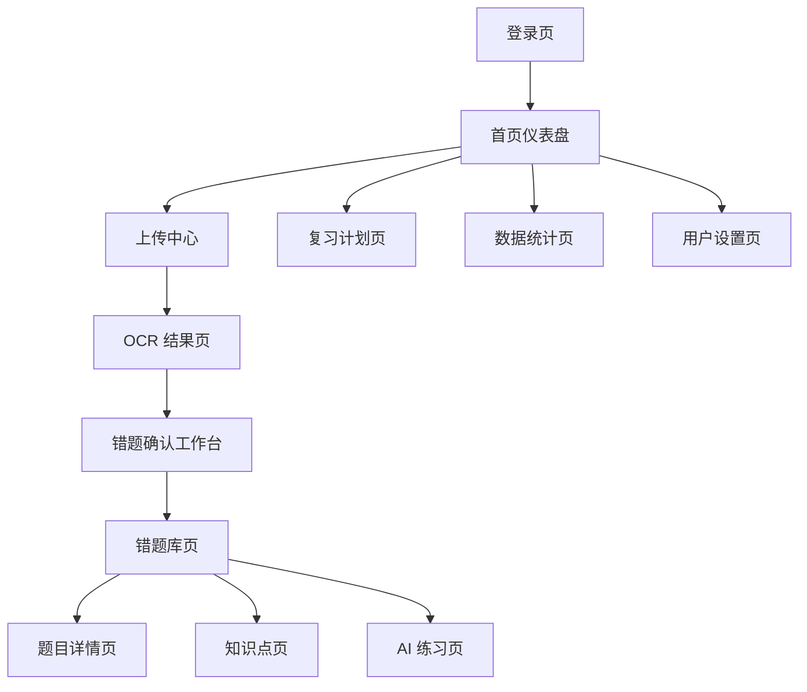
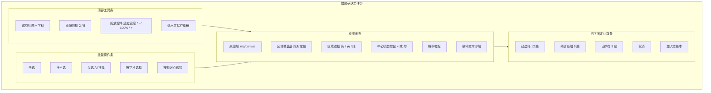
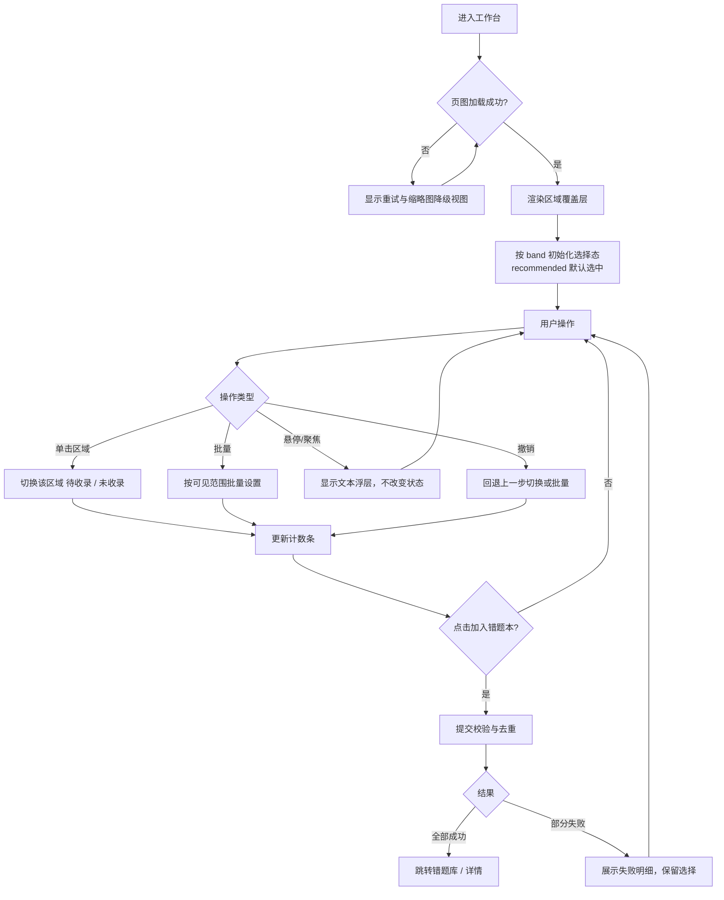
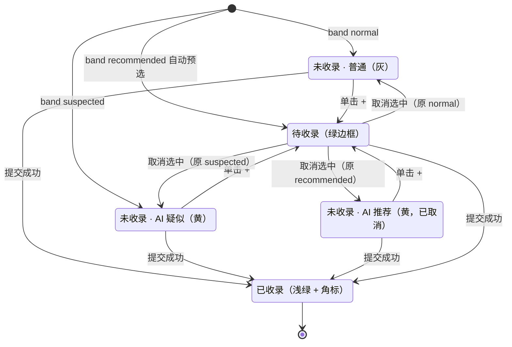

# MistakeBook AI UI / UX 设计

| 文档项 | 内容 |
| --- | --- |
| 文档版本 | 0.2（V1.1 增量基线） |
| 文档状态 | 依据 PRD V1.1 编写；待产品方评审 PRD 后定稿 |
| 说明 | 本文件在 V1.1 前不存在。本版聚焦错题确认工作台，其余页面给出信息架构但不视为已完成设计 |
| 关联 | `PRD.md` 第 5.7–5.8 节、`Architecture.md`、`Database.md` |

## 1. 设计原则

1. **在证据上做决定**：用户判断“是否错题”时必须同时看到原图区域、识别文字与概率依据，不依赖记忆或来回切换。
2. **单击即可，不打断**：切换收录状态是一级操作，任何弹窗都是额外成本。确认、撤销都应在原地完成。
3. **状态一眼可辨**：颜色只承载一种含义，避免同一绿色同时表示“AI 推荐”和“已收录”。
4. **可恢复**：误点、刷新、会话过期都不能让用户的确认工作白做。
5. **可键盘操作**：批量确认场景下，键盘与鼠标同等重要。

## 2. 信息架构

工作台的进入路径有两条：处理完成后自动跳转，以及从 OCR 结果页手动进入。二者指向同一路由，避免两套界面。

## 3. 页面结构图（错题确认工作台）

布局要点：

- 画布占据主要视口，工具条与计数条不遮挡题干；计数条固定右下，滚动时保持可见。
- 批量操作条位于画布上方或侧边，不与计数条争夺右下角。
- 窄屏（平板竖屏）下降级为单页滚动 + 底部固定计数条，仍保持图片直接操作。

## 4. 用户操作流程图

## 5. 状态流转与视觉编码

### 5.1 视觉优先级（关键决策）

原变更请求同时规定“AI 推荐错题 = 黄色边框”和“已选中收录 = 绿色边框”。在 `wrong_probability >= 85` 自动预选的情况下，这条规则自相矛盾：该区域既是“AI 推荐”，又是“已选中”。

V1.1 采用**单通道优先级**编码：边框任一时刻只有一种颜色，按固定优先级取值；概率分值由独立徽标展示。

| 优先级 | 边框/填充 | 触发条件 |
| --- | --- | --- |
| 1 | 浅绿填充 + “已收录”角标，按钮锁定 | 已写入错题本 |
| 2 | 绿色边框 | 本次已选中（含 `>=85` 的默认预选） |
| 3 | 黄色边框 | 未选中，且 band 为 `recommended` 或 `suspected` |
| 4 | 灰色边框 | 未选中，且 band 为 `normal` |

推导结果：

| band | 未收录 | 待收录 | 已收录 |
| --- | --- | --- | --- |
| `>=85` recommended | **黄边框**（用户取消后） | **绿边框**（初始默认，`+` 已变 `✓`） | 浅绿填充 + 角标 + 不可点击 |
| `50–84` suspected | **黄边框** | 绿边框 | 浅绿填充 + 角标 + 不可点击 |
| `<50` normal | **灰边框** | 绿边框 | 浅绿填充 + 角标 + 不可点击 |

这样“一眼看到哪些题已加入错题本”仍然成立：绿色边框代表本次将收录；浅绿填充 + “已收录”角标代表数据库中已存在；黄色代表 AI 认为可能错但用户尚未选中。灰/黄/绿的语义与变更请求一致，且不存在同一区域被两条规则抢占颜色的情况。

### 5.2 状态流转图

实现提示：前端需保存“该区域原始 band”，取消选中时据此恢复，而不是把颜色硬编码回灰色。这是最容易写错的地方。

### 5.3 无障碍与颜色替代

- 不使用颜色作为唯一信息通道：`+` / `✓` 字符、角标文本、`aria-label` 均需表达状态。
- 边框同时使用线宽差异（待收录 2px，已收录 2px + 填充）辅助区分。
- 对比度满足 WCAG AA；黄/绿徽标需带深色文字。

## 6. 交互细节

| 元素 | 行为 | 备注 |
| --- | --- | --- |
| 区域中心按钮 | 单击切换，`+` ↔ `✓` | 按钮尺寸不小于 32×32 CSS 像素，缩放时保持可点 |
| 区域边框 | 单击边框等同单击按钮 | 扩大命中区，减少精确点击负担 |
| 概率徽标 | 只读展示 | 悬停显示分档说明 |
| 文本浮层 | 悬停 300ms 或键盘聚焦显示 | 含题号、概率、识别文本摘要、判定依据 |
| 缩放 | 25%–400%，按钮 + `Ctrl/⌘ +/-` | 缩放只改视图矩阵，不改坐标 |
| 平移 | 空格拖动或中键拖动 | 小屏支持双指 |
| 撤销 | `Ctrl/⌘ Z`，或批量后出现的短时撤销条 | 至少回退一次批量 |
| 提交按钮 | 无选择时禁用 | 文案固定为“加入错题本” |
| 离开页面 | 自动保存草稿 | 恢复时提示“已恢复上次选择” |

### 6.1 错误与空状态文案

| 场景 | 文案方向 |
| --- | --- |
| 未检测到题目 | “本页未识别到题目区域。可查看原图后重新识别。” |
| 概率评估失败 | “未评估”徽标，按普通题展示，仍可手动选择 |
| 页图加载失败 | “原图加载失败，已切换到缩略图视图。” + 重试 |
| 提交部分失败 | “12 题中 9 题已加入，3 题失败：…” + 重试失败项 |
| 全部已存在 | “所选题目均已在错题本中。” + 查看错题库 |

## 7. 其余页面（信息架构级）

| 页面 | 核心内容 | V1.1 关联点 |
| --- | --- | --- |
| 登录页 | 本地账号 + 外部登录入口 | 无 |
| 首页仪表盘 | 最近试卷、待确认数量、今日复习 | 需展示“待确认”入口直达工作台 |
| 上传中心 | 批量选择、逐文件状态 | 完成后跳转工作台 |
| OCR 结果页 | 页级识别状态、置信提示 | 提供“进入确认工作台”主按钮 |
| 错题库页 | 筛选（学科/知识点/时间/难度/次数） | 显示区域缩略图 |
| 题目详情页 | 原图区域 + 识别文本 + 分析 + 复习历史 | 可回溯到来源页与区域 |
| 知识点页 | 知识点树与相关错题 | 供批量按知识点选择时预览 |
| AI 练习页 | 5/10/20 题生成 | 无 |
| 复习计划页 | 今日/本周/本月 | 无 |
| 数据统计页 | 错因、知识点、趋势 | 无 |
| 用户设置页 | 账号、存储、AI 提供方 | 无 |

## 8. 设计交付检查

- [x] 页面结构图（Mermaid）
- [x] 状态流转图（Mermaid）
- [x] 用户操作流程图（Mermaid）
- [x] 颜色语义不再自相矛盾，并说明推导结果
- [x] 键盘、缩放、撤销、草稿恢复均有定义
- [x] 异常与空状态文案方向
- [ ] 高保真视觉稿（需设计工具产出，不在本阶段）
- [ ] 移动端断点细节（待产品确认是否必须支持手机上传+确认）

## 9. V1.1 UI Review

- 已确认：主交互为图片直接操作，列表勾选不作为唯一入口。
- 已确认：三张 Mermaid 图齐备，且状态机覆盖“取消选中后恢复原档位”这一易错分支。
- 已确认：冲突的颜色规则已消解并有推导表，可直接进入实现。
- 待确认：是否必须支持手机端完成确认流程；区域边界手工编辑是否首期。
- 结论：**交互设计可进入开发，视觉稿待补。**
